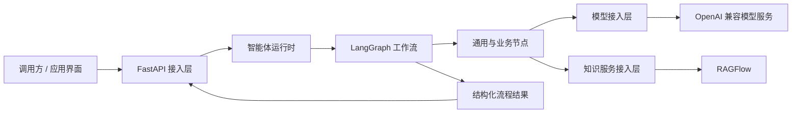

<div align="center">

# AgentPlatform

### 面向智能体应用构建与运行的模块化平台工程

以清晰的工作流编排和可复用组件为基础，让智能体能力可以逐步接入、组合与演进。

**Python 3.12 / 3.13** · **FastAPI** · **LangChain** · **LangGraph** · **RAGFlow**

</div>

---

## 平台介绍

AgentPlatform 是一个用于构建智能体应用的工程底座。项目将接口接入、流程编排、通用节点、模型调用和外部知识服务分层组织，减少业务流程与基础设施之间的耦合。

平台关注的是智能体应用如何被组织和扩展：流程由节点组成，节点通过明确的数据状态协作，模型与知识服务通过独立接入层连接。新的应用可以沿用平台结构逐步建设，而不必把所有逻辑集中在单一入口中。

> **项目方向**：模块化组织 · 显式流程编排 · 通用能力复用 · 基础设施可替换

## 架构概览



### 分层职责

| 层次 | 职责 |
| --- | --- |
| API 接入 | 接收请求、校验输入并返回处理结果 |
| 运行时与流程 | 启动工作流，管理节点之间的状态流转 |
| 节点 | 封装可复用处理步骤，组合成完整流程 |
| 基础设施 | 对接模型服务、知识服务等外部依赖 |

## 技术基础

| 领域 | 当前技术 |
| --- | --- |
| 语言与服务 | Python 3.12 / 3.13、FastAPI |
| 智能体编排 | LangChain、LangGraph |
| 知识服务 | RAGFlow |
| 配置与数据校验 | Pydantic、pydantic-settings |
| HTTP 通信 | HTTPX |

当前基础工程不依赖 Redis。仓库现阶段以 Python 后端为主，前端可独立接入。

## 代码结构

```text
Agent/
├── backend/
│   ├── app/
│   │   ├── agents/          # 工作流与智能体组织
│   │   ├── api/             # HTTP 接口
│   │   ├── core/            # 配置、错误处理与日志
│   │   ├── infrastructure/  # 模型及外部服务接入
│   │   ├── nodes/            # 可跨流程复用的通用节点
│   │   ├── runtime/          # 工作流运行入口
│   │   ├── schemas/          # 请求、响应和数据结构
│   │   └── services/         # 应用服务
│   ├── pyproject.toml
│   └── README.md             # 后端配置与启动说明
└── README.md                 # 平台介绍
```

## 开始使用

后端环境配置、依赖安装、启动方式和接口说明见 [后端 README](backend/README.md)。

---

<div align="center">
<sub>AgentPlatform · 为可组合、可演进的智能体应用而构建</sub>
</div>
