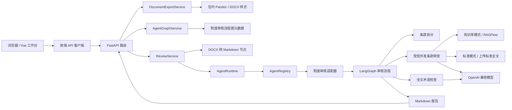

<div align="center">

# AgentPlatform

### 面向智能体应用构建与运行的模块化平台工程

当前提供基于 DOCX 的制度审核工作流，包含 Vue 前端、FastAPI 后端，以及 OpenAI 兼容模型和 RAGFlow 接入。

**Python 3.12 / 3.13** · **FastAPI** · **LangChain / LangGraph** · **Vue 3 / TypeScript** · **RAGFlow**

</div>

---

## 项目现状

AgentPlatform 用分层结构组织智能体应用：前端通过 API 提交任务，后端服务处理文档并调用运行时；具体智能体负责流程编排，外部模型和知识库通过基础设施客户端接入。

目前已实现的业务是制度审核：上传 DOCX 制度草稿后，选择知识库审核，或再上传一份 DOCX 标准文档直接对比。后端将文档转成 Markdown，按章、节和条拆分，使用模型检查条款冲突、重复和术语问题，最终返回 Markdown 报告。前端采用暖白与陶土色界面，提供宣传首页、智能体目录，以及会话助手和制度审核两个独立工作页面；图标统一使用 Lucide。

标准文档模式不调用 RAGFlow 或 embedding，知识库检索额度不足时仍可使用。草稿超过 30 个条款块时，按原顺序合并相邻条款至 30 组，保留原文和逐条定位。条款任务并发数通过 `INSTITUTION_REVIEW_CONCURRENCY` 配置，默认 3，由同进程的制度审核请求共享；多个工作进程各自计算额度。

当前增加会话助手：可直接聊天、可选上传 DOCX 或粘贴正文；先识别意图，普通聊天、制度知识问答和摘要不调用审核，明确制度审核且参数齐全时才调用已有智能体，并原样展示结果。入口为 `/agents/conversation-assistant`。

助手左侧从后端分页读取会话记录，上传文件在输入框预览并随所属消息展示。普通对话通过 SSE 实时显示模型输出，调用制度审核时推送真实状态并展示完整结果。切换会话保留草稿与文件选择，离开后关闭订阅，返回时恢复同一任务；历史保存到 PostgreSQL，刷新或重启后可恢复；未发送草稿仍仅在页面内存。制度审核报告保留完整 Markdown，并提供章节导航、复制、独立 Word 下载和明确的停止等待操作。

智能体元数据、会话、消息、文件路径及完整子调用结果保存到 PostgreSQL；上传原件与解析正文存放在 backend/documents 的 agent/session/file 分级目录，不自动过期。服务重启后未完成运行标记中断，不自动重做。活动任务、SSE 临时文本及取消句柄仍在单进程内存，请使用单工作进程；同库第二实例会拒绝启动。当前没有登录、用户权限隔离、长期记忆、长对话摘要或 Redis，独立审核表单不新增历史功能。

后端另提供独立 Markdown 转 Word 下载接口，使用 Python 依赖自带的 Pandoc 转换、python-docx 统一样式，不依赖模型配置或系统级安装 Pandoc。原制度审核报告页可点击“下载 Word”保存当前报告；会话页本次仅展示调用结果，不增加下载、报告版本或新业务流程，MCP 尚未接入。

## 架构概览

会话助手支持单条永久删除：确认后清理会话消息、运行结果及上传文件；忙碌目标须先等待或停止并等其结束。附件清理失败可以重试，服务启动会核对待清理凭据。删除最后一条后保持空态，首次进入空历史也需点击“新建对话”才创建；不提供撤销、回收站或批量清理，不涉及用户下载副本、外部追踪和备份。



应用启动时创建模型，并在知识库配置齐备时注入 RAGFlow 客户端。聊天模型配置完整即可初始化运行时。父图先并行完成条款拆分和全文术语检查，再进入官方 LangGraph Send 条款子图，按审核模式分发单组任务、校验完整性并有序汇总，最后生成简述、冲突检测、术语检测和修改建议四部分报告。通过条款不进入后续问题汇总上下文。

条款子图沿用父图构建时的共享 semaphore，保留同进程跨请求额度；旧批量调度代码已移除。静态流程页面仍展示父图概览，不展开动态 chunk。当前没有图层重试、持久检查点或跨进程恢复；失败重新提交会重做，取消只保证本进程任务清理和额度释放。

## 技术栈

| 部分 | 技术 |
| --- | --- |
| 后端 | Python 3.12 / 3.13、FastAPI、Pydantic、HTTPX |
| 智能体流程 | LangChain、LangGraph |
| 模型与知识库 | OpenAI 兼容聊天模型、RAGFlow |
| 前端 | Vue 3、TypeScript、Vue Router、Vite |
| Markdown 报告 | marked、DOMPurify |
| Word 导出 | pypandoc-binary、python-docx |

## 代码结构

```text
Agent/
├── backend/
│   ├── database/                   # 显式建库与当前 v2 建表 SQL
│   ├── documents/                  # 会话文件原件与正文，运行时生成并被 Git 忽略
│   ├── app/
│   │   ├── agents/institution_review/  # 制度审核适配器、图、状态和专属节点
│   │   ├── api/                        # 审核与健康检查路由
│   │   ├── core/                       # 配置、错误处理和请求日志
│   │   ├── infrastructure/             # 模型与 RAGFlow 客户端
│   │   ├── nodes/document/             # DOCX 转 Markdown 节点
│   │   ├── runtime/                    # 智能体注册与调用运行时
│   │   ├── schemas/                    # 审核报告共享结构
│   │   └── services/                   # 审核用例协调
│   ├── tests/
│   └── README.md                       # 后端配置、启动和 API 说明
├── frontend/
│   ├── src/
│   │   ├── api/                        # API 客户端
│   │   ├── features/institution-review/ # 上传和报告界面
│   │   ├── components/                 # 工作台共享组件
│   │   ├── router/                     # 页面路由
│   │   └── views/                      # 首页、广场和工作台
│   └── README.md                       # 前端配置和启动说明
├── docs/database.md                # 数据库设计、结构与初始化入口
├── docs/ai-coding/                     # 项目治理、架构和质量规则
└── README.md
```

## 本地启动

需要 PostgreSQL 18（先按后端说明执行 SQL 初始化）、Python 3.12 或 3.13、[uv](https://docs.astral.sh/uv/)，以及 Node.js 20.19+ 或 22.12+ 和 pnpm。先按各自 README 配置后端模型与 RAGFlow 参数，然后在两个终端分别启动：

```powershell
# 终端一：后端
cd backend
Copy-Item .env.example .env
uv sync
uv run uvicorn app.main:create_app --factory --reload
```

```powershell
# 终端二：前端
cd frontend
Copy-Item .env.example .env.local
pnpm install
pnpm dev
```

前端开发服务器默认将 `/api` 代理到 `http://127.0.0.1:8000`。详细配置见 [后端 README](backend/README.md) 和 [前端 README](frontend/README.md)。

## 当前入口

- `GET /api/v1/agents`：数据库智能体展示目录；会话接口统一使用 `/api/v1/sessions` 与 session_id/message_id/run_id/file_id。
- `GET /health/live`：进程存活检查。
- `GET /health/ready`：检查模型配置与审核运行时，并分别返回两种模式的配置可用性；不探测外部连通或账户额度。
- `POST /api/v1/reviews`：以 `multipart/form-data` 上传草稿 `file`，以及审核方式 `review_mode`；`standard_document` 模式还需 `standard_file`，返回 `text/markdown` 审核报告。缺省方式为 `knowledge_base`，兼容原有单文件请求。
- `GET /api/v1/agents/institution_review/graph`：返回制度审核流程的静态节点和连线结构，不依赖运行时就绪状态，也不包含节点执行进度。
- `POST /api/v1/documents/export/docx`：JSON 提交 `markdown` 和可选 `title`，返回 DOCX 附件。支持文本、列表、代码及表格，首版拒绝图片与原始 HTML；限制、样式及示例见 [后端 README](backend/README.md#markdown-导出-word)。
- 前端 `/`、`/agents`、`/agents/conversation-assistant`、`/agents/institution-review`、`/agents/institution-review/flow`：宣传首页、智能体目录、会话助手、制度审核工作台和静态流程结构图。

## 质量检查

后端已接入可选的本地 Langfuse：记录 Agent/图/模型/检索调用链、供应商 Token，关联 Prompt 版本并执行合成数据集实验。费用需要匹配模型价格，正文采集默认关闭。配置、初始化、实验及回退方法见 [后端 Langfuse 说明](backend/README.md#langfuse-追踪prompt-与实验)。凭据只保存在后端本地环境配置。

后端在 `backend/` 执行：

```powershell
uv run ruff check app tests
uv run pytest
```

前端在 `frontend/` 执行：

```powershell
pnpm build
```

GitHub Actions 会在 Pull Request 和推送到 `main`、`dev` 时运行后端检查与测试，以及前端生产构建。

---

<div align="center">
<sub>AgentPlatform · 为可组合、可演进的智能体应用而构建</sub>
</div>
