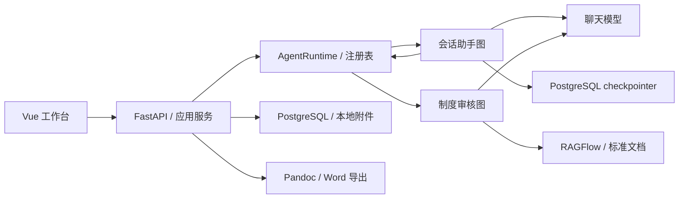

<div align="center">

# AgentPlatform

### 面向智能体应用构建与运行的模块化平台工程

提供会话助手与 DOCX 制度审核，包含 Vue 前端、FastAPI 后端，以及 OpenAI 兼容模型和 RAGFlow 接入。

**Python 3.12 / 3.13** · **FastAPI** · **LangChain / LangGraph** · **Vue 3 / TypeScript** · **RAGFlow**

</div>

---

## 项目现状

- **制度审核**：上传 DOCX 草稿，选择知识库审核或标准文档对比，生成包含条款定位的 Markdown 报告；标准文档模式无需 RAGFlow。
- **会话助手**：支持聊天、粘贴正文和可选附件；明确审核意图且参数齐全后调用制度审核，通过 SSE 展示回答与执行状态。
- **短期记忆与历史**：官方 PostgreSQL checkpointer 保存成功轮次、摘要和待补参；完整历史与报告单独归档，附件保存在本地。支持会话永久删除及清理失败重试。
- **账号与导出**：支持注册、登录、个人账号和管理员用户管理，会话按用户隔离；提供 Markdown 转 Word 下载。
- **可观测性**：可选接入 Langfuse，记录调用链、Token 用量、Prompt 版本与合成数据集实验，正文采集默认关闭。

当前采用单工作进程，同库第二实例会拒绝启动；重启后未完成任务标记中断，不自动重做。长期记忆、Redis 和 MCP 尚未接入。

## 架构概览

前端通过 API 调用应用服务，服务将智能体任务交给统一运行时；各 Agent 使用 LangGraph 编排业务流程。



制度审核使用官方 Send 分发条款任务，并共享同进程并发额度；独立审核图不配置持久恢复。实现细节见 [后端 README](backend/README.md)。

## 技术栈

| 部分 | 技术 |
| --- | --- |
| 后端 | Python 3.12 / 3.13、FastAPI、Pydantic、HTTPX |
| 智能体流程 | LangChain、LangGraph |
| 持久化 | PostgreSQL、官方 PostgreSQL checkpointer、本地附件 |
| 模型与知识库 | OpenAI 兼容聊天模型、RAGFlow |
| 前端 | Vue 3、TypeScript、Vue Router、Vite |
| Markdown 报告 | marked、DOMPurify |
| Word 导出 | pypandoc-binary、python-docx |

## 项目架构与目录

目录见[项目架构目录](docs/ai-coding/project-structure.md)，职责边界见[架构规则](docs/ai-coding/architecture-rules.md)，协作约定见 [AGENTS.md](AGENTS.md)。

## 本地启动

需要 PostgreSQL 18、Python 3.12 / 3.13、[uv](https://docs.astral.sh/uv/)、Node.js 20.19+ 或 22.12+ 和 pnpm。在两个终端分别启动：

```powershell
# 终端一：后端
cd backend
Copy-Item .env.example .env  # 仅首次准备；已有配置时跳过
uv sync
# 填写 .env，并按数据库说明完成初始化后启动
uv run uvicorn app.main:create_app --factory --reload --loop app.infrastructure.conversation.checkpoints:event_loop_factory
```

**Windows 特殊情况**：`--loop ...:event_loop_factory` 使用项目提供的事件循环工厂，在 Windows 下选择 Selector，因为 PostgreSQL 检查点使用的 Psycopg 异步驱动不支持默认的 Proactor。其他系统也可使用上面的命令；`--reload` 用于开发时自动重启。

```powershell
# 终端二：前端
cd frontend
Copy-Item .env.example .env.local  # 仅首次准备；已有配置时跳过
pnpm install
pnpm dev
```

前端开发服务器默认将 `/api` 代理到 `http://127.0.0.1:8000`。详细配置见 [后端 README](backend/README.md) 和 [前端 README](frontend/README.md)。

## 账号与部署

注册与登录入口为 `/register`、`/login`，本人资料与改密位于 `/account`，支持头像、邮箱、性别、生日、手机号、地址和个性签名。管理员在 `/admin/users` 管理账号并只读查看资料，不能读取其他人的会话。

当前数据库结构为 v4，应用启动不自动建表或迁移。新环境须显式初始化，已有旧结构测试库需另建空环境；不提供旧版迁移或兼容入口。初始化、管理员密码恢复及备份步骤见[数据库说明](docs/database.md)。

## 当前入口

- `GET /api/v1/agents`：智能体目录；会话相关接口位于 `/api/v1/sessions`。
- `GET /health/live`：进程存活检查。
- `GET /health/ready`：检查模型配置与审核运行时，并分别返回两种模式的配置可用性；不探测外部连通或账户额度。
- `POST /api/v1/reviews`：上传 DOCX 草稿及可选标准文档，返回 Markdown 审核报告。
- `GET /api/v1/agents/institution_review/graph`：制度审核静态流程结构。
- `POST /api/v1/documents/export/docx`：提交 Markdown，下载 DOCX。详细参数见 [后端 README](backend/README.md)。
- 前端 `/`、`/agents`、`/agents/conversation-assistant`、`/agents/institution-review`、`/agents/institution-review/flow`：宣传首页、智能体目录、会话助手、制度审核工作台和静态流程结构图。

## 质量检查

后端在 `backend/` 执行：

```powershell
uv run ruff check app scripts tests
uv run pytest
```

数据库测试须显式设置指向专用测试库的 `TEST_DATABASE_URL`，准备步骤见[数据库测试与维护](docs/database.md#测试与维护)。

前端在 `frontend/` 执行：

```powershell
node --test src/features/conversation-assistant/useConversation.test.cjs src/features/auth/useAuth.test.cjs src/features/auth/appLifecycle.test.cjs src/api/auth.test.cjs
pnpm build
```

GitHub Actions 会在 Pull Request 和推送到 `main`、`dev` 时运行后端检查与测试，以及前端生产构建。

---

<div align="center">
<sub>AgentPlatform · 为可组合、可演进的智能体应用而构建</sub>
</div>
