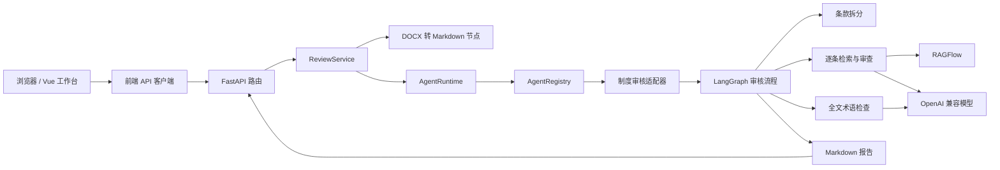

<div align="center">

# AgentPlatform

### 面向智能体应用构建与运行的模块化平台工程

当前提供基于 DOCX 的制度审核工作流，包含 Vue 前端、FastAPI 后端，以及 OpenAI 兼容模型和 RAGFlow 接入。

**Python 3.12 / 3.13** · **FastAPI** · **LangChain / LangGraph** · **Vue 3 / TypeScript** · **RAGFlow**

</div>

---

## 项目现状

AgentPlatform 用分层结构组织智能体应用：前端通过 API 提交任务，后端服务处理文档并调用运行时；具体智能体负责流程编排，外部模型和知识库通过基础设施客户端接入。

目前已实现的业务是制度审核：上传 DOCX 制度草稿后，后端将文档转成 Markdown，按章、节和条拆分，并结合 RAGFlow 知识库和 OpenAI 兼容模型检查条款冲突、重复和术语问题，最终返回 Markdown 报告。前端提供首页、智能体广场和制度审核工作台。

当前版本不保存审核结果，不提供登录、审核历史、会话、流式输出或节点级进度；项目没有关系型数据库或 Redis。

## 架构概览



应用启动时创建模型和 RAGFlow 客户端，并将它们注入制度审核流程。流程并行执行逐条知识库审查和全文术语检查，再生成简述、冲突检测、术语检测和修改建议四部分报告。

## 技术栈

| 部分 | 技术 |
| --- | --- |
| 后端 | Python 3.12 / 3.13、FastAPI、Pydantic、HTTPX |
| 智能体流程 | LangChain、LangGraph |
| 模型与知识库 | OpenAI 兼容聊天模型、RAGFlow |
| 前端 | Vue 3、TypeScript、Vue Router、Vite |
| Markdown 报告 | marked、DOMPurify |

## 代码结构

```text
Agent/
├── backend/
│   ├── app/
│   │   ├── agents/institution_review/  # 制度审核适配器、图、状态和专属节点
│   │   ├── api/                        # 审核与健康检查路由
│   │   ├── core/                       # 配置、错误处理和请求日志
│   │   ├── infrastructure/             # 模型与 RAGFlow 客户端
│   │   ├── nodes/document/             # DOCX 转 Markdown 节点
│   │   ├── runtime/                    # 智能体注册与调用运行时
│   │   ├── schemas/                    # 审核报告共享结构
│   │   └── services/                   # 审核用例协调
│   ├── tests/
│   └── README.md                       # 后端配置、启动和 API 说明
├── frontend/
│   ├── src/
│   │   ├── api/                        # API 客户端
│   │   ├── features/institution-review/ # 上传和报告界面
│   │   ├── components/                 # 工作台共享组件
│   │   ├── router/                     # 页面路由
│   │   └── views/                      # 首页、广场和工作台
│   └── README.md                       # 前端配置和启动说明
├── docs/ai-coding/                     # 项目治理、架构和质量规则
└── README.md
```

## 本地启动

需要 Python 3.12 或 3.13、[uv](https://docs.astral.sh/uv/)，以及 Node.js 20.19+ 或 22.12+ 和 pnpm。先按各自 README 配置后端模型与 RAGFlow 参数，然后在两个终端分别启动：

```powershell
# 终端一：后端
cd backend
Copy-Item .env.example .env
uv sync
uv run uvicorn app.main:create_app --factory --reload
```

```powershell
# 终端二：前端
cd frontend
Copy-Item .env.example .env.local
pnpm install
pnpm dev
```

前端开发服务器默认将 `/api` 代理到 `http://127.0.0.1:8000`。详细配置见 [后端 README](backend/README.md) 和 [前端 README](frontend/README.md)。

## 当前入口

- `GET /health/live`：进程存活检查。
- `GET /health/ready`：检查模型、RAGFlow 配置及审核运行时是否就绪。
- `POST /api/v1/reviews`：以 `multipart/form-data` 上传 `file` 字段中的 `.docx` 文件，返回 `text/markdown` 审核报告。
- 前端 `/`、`/agents`、`/agents/institution-review`：平台首页、智能体广场和制度审核工作台。

## 质量检查

后端在 `backend/` 执行：

```powershell
uv run ruff check app tests
uv run pytest
```

前端在 `frontend/` 执行：

```powershell
pnpm build
```

GitHub Actions 会在 Pull Request 和推送到 `main` 时运行后端检查与测试，以及前端生产构建。

---

<div align="center">
<sub>AgentPlatform · 为可组合、可演进的智能体应用而构建</sub>
</div>
