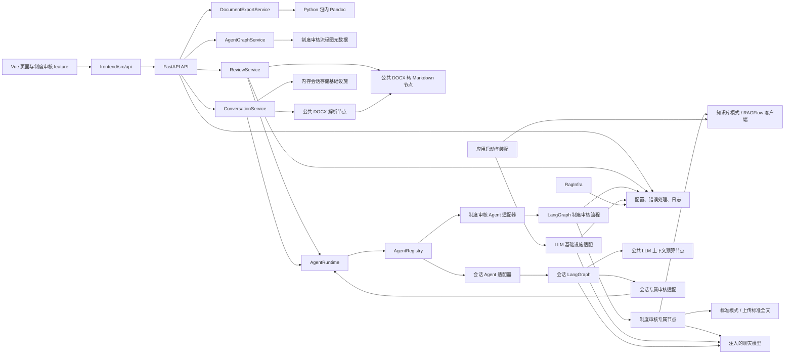

# 当前架构与架构约束

## 当前架构图

以下图示描述仓库当前代码中可见的主要调用关系，不表示尚未实现的规划模块。

图中 `Main` 创建模型，在 RAGFlow 配置完整时创建可选 RAG 客户端，并将其和制度审核并发配置交给 Agent 构建上下文。聊天模型配置就绪即可初始化运行时。知识库模式调用注入的 `app.infrastructure.ragflow.client.RagFlowClient`；标准模式比较上传标准全文，不调用检索或 embedding。不要把图理解为已经存在通用的 RAG 节点或服务抽象。

制度审核图构建时创建共享异步并发额度，由同进程的制度审核请求共用。原始 `clauses` 和执行 `chunks` 分开保存；仅标准模式将超过 30 个块的相邻条款合并为 30 组。依据来源选择、分组、发现定位和并发规则属于制度审核 Agent，通用 `runtime/` 不承载这些业务规则。就绪接口主状态反映模型配置和运行时，两种模式的配置状态分开报告，不检查外部连通或额度。

显示标题规范化或截断时，另行保留原始文档标题供拆分定位使用，避免标题被当作正文。全文术语分支在调用模型前同样检查可审核内容；它与拆分并行运行，因此独立执行纯文本校验。报告仅携带问题相关依据，标准模式保留已验证摘录的完整内容，不沿用知识库报告片段截断。

只读流程结构接口 `GET /api/v1/agents/{agent_id}/graph` 由 API 路由委托给 `AgentGraphService`，再读取制度审核 Agent 中定义的静态图元数据。该响应描述节点和连线，不是 LangGraph 运行时状态或节点执行进度。

独立导出接口 `POST /api/v1/documents/export/docx` 委托 `DocumentExportService` 校验 Markdown、检查 AST 并设置 Word 样式，使用基础设施 `PandocRunner` 调用 pypandoc-binary 包内程序。服务在 lifespan 中独立于模型配置装配，持有同进程共享额度、取消及关闭逻辑。文件通过内存返回，未增加附件存储、MCP 或 Chat 工具，也不把转换放入制度审核图或 AgentRuntime。

## 已有目录职责

会话助手使用完整的 `agents/conversation_assistant/graph/` LangGraph，依次准备材料、构造上下文、识别意图和门控，再进入普通回复、澄清或审核子调用。参数合并、模式校验和目标白名单归 Agent；`ConversationService` 每轮只调用一次会话 Agent，负责后台任务、幂等、容量、超时、取消、上传用例和 HTTP 映射，不再解释意图或审核参数。

`infrastructure/conversation/in_memory_store.py` 保存消息、完整材料、运行记录和不透明续接数据，并管理 TTL、锁和容量计数；中立记录结构位于 `schemas/conversation_session.py`，本轮契约位于 `schemas/conversation_turn.py`。这类应用会话存储与 Agent 的 `graph/state.py` 分开。未启用图检查点，不维护第二份消息历史。

上传时调用 `nodes/document/parse.py` 完成格式及解压校验，并复用 `docx_to_markdown.py`，会话图使用解析结果，不重复解析。通用序列化预算及裁剪归 `nodes/llm/context.py`，会话材料选择归专属 `nodes/context_prepare.py`。模型输入预算为 24000 个序列化字符，历史子结果片段最多 4000 字符；这不是模型 token 上限。子调用按材料 ID 获取完整原文。

会话专属 `tools/institution_review.py` 只适配已接入审核能力；图通过构建上下文注入的调用函数，使用生产环境同一个 `AgentRuntime` 调用原有制度审核 Agent。注册期间不执行调用，全部注册成功后才发布运行时；制度审核图继续在启动时构建并共享额度，没有通用工具中心或自动多智能体执行循环。运行时执行公共契约不变，注册表工厂允许注入注册表及调用函数以完成装配。

DOCX 上传可选，粘贴正文引用当前会话用户消息。消息、结果、待补齐审核参数与材料只留在内存；服务关闭先回收后台任务，再关闭外部客户端。前端 `features/conversation-assistant/` 负责聊天交互，`AgentConversationView.vue` 负责页面组合。当前使用轮询，不提供流式输出、跨进程恢复或用户权限隔离。

### 后端 `backend/app/`

| 目录 | 当前职责与约束 |
| --- | --- |
| `api/` | FastAPI 路由和 HTTP 输入输出。将业务协调委托给服务层。 |
| `core/` | 配置、统一错误和日志等应用级基础能力。 |
| `services/` | 应用用例协调，服务模块使用 `*_service.py`。会话只保留 `conversation_service.py`，不承载 Agent 编排或存储/解析/上下文辅助文件。原独立审核与导出服务仍承担各自用例。 |
| `runtime/` | 通用智能体调用上下文、注册表、分发和执行结果。 |
| `agents/` | 具体智能体及其构建入口。当前由 `agents` 包发现子包并调用 `register_agent`。 |
| `agents/institution_review/graph/` | 制度审核 LangGraph 状态、图和路由边。 |
| `agents/institution_review/nodes/` | 制度审核专属节点、提示调用和业务结构。 |
| `nodes/` | 公共处理能力，包括 DOCX 转换、解析校验和 LLM 输入预算。会话业务材料选择不进入通用 LLM 节点；公共节点也可独立于图调用。 |
| `infrastructure/` | 外部系统/SDK 适配及具体存储实现，包括聊天模型、RAGFlow、Pandoc 和会话内存存储。存储实现不解释 Agent 业务或返回 HTTP View。 |
| `schemas/` | 应用级审核响应与引用等共享数据结构。Agent 私有结构保留在 Agent 包内。 |

### 前端 `frontend/src/`

| 目录/文件 | 当前职责与约束 |
| --- | --- |
| `api/` | API 基础客户端和审核 API 封装。 |
| `features/institution-review/` | 制度审核相关上传、报告和类型。新审核 UI 行为优先放在此 feature。 |
| `components/` | 可复用界面组件；当前有工作台执行状态组件。新建通用组件前确认存在多个真实使用点或明确共享契约。 |
| `views/` | 路由页面及页面级组合。 |
| `router/` | Vue Router 配置。 |
| `App.vue`、`main.ts`、`style.css` | 应用入口、外壳和全局样式。 |

## 依赖边界

- 后端 HTTP 路由依赖服务及应用级配置/错误设施；服务协调用例并调用运行时或明确可复用节点。
- `runtime/` 保持通用调用协议，不放入制度审核领域逻辑。
- Agent 的图、状态和私有节点属于相应 Agent 包；跨 Agent 复用的能力应先证明有真实复用需求，再评估放入 `nodes/` 或共享 schema。
- `infrastructure/` 处理外部系统/SDK 接入与具体存储实现。业务流程不应绕过已有服务/构建上下文任意新建外部客户端；Agent 不导入会话存储或反向依赖 services。
- 前端页面通过 `api/` 访问后端；业务 UI 细节归属 feature，`views/` 负责页面组合。
- 不因目录名称推导尚未存在的接口或职责。新增边界、跨层反向依赖或公共契约变化按治理流程请求确认。

## 复用、新模块与目录创建

1. 搜索相关符号、API、组件和调用方，再决定新增或复用。
2. 一个职责属于已有模块时优先扩展该模块。不要创建仅转发调用、包装一次或为未来复用而设的重复模块。
3. 新 Agent 应实现当前 `register_agent(registry, context)` 注册约定，并具有实际业务需求；新增通用运行时机制须单独说明必要性。
4. `backend/app/`、`frontend/src/` 下的新一级目录，以及新的仓库顶层目录，必须先说明现有目录为何不能承载职责并获得用户确认。
5. 新增文件放在已批准的职责目录内，并更新受影响的 README 或架构说明。

## 当前架构文档状态

`docs/superpowers/智能体平台项目架构图_v2.md` 是规划材料，其中的数据库、认证、stores、消息队列和其他模块不代表当前实现。评估变更时以代码和本文件的“当前架构图”为准；未来计划须明确标注为计划，并单独审批。
