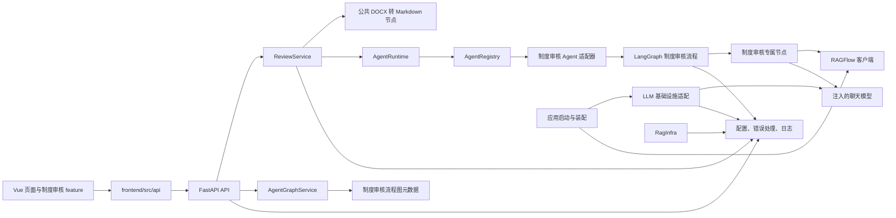

# 当前架构与架构约束

## 当前架构图

以下图示描述仓库当前代码中可见的主要调用关系，不表示尚未实现的规划模块。

图中 `Main` 创建模型和 RAG 客户端并将其交给 Agent 构建上下文；`AgentNodes` 调用注入的模型及 RAG 客户端。制度审核图节点目前直接使用 `app.infrastructure.ragflow.client.RagFlowClient`。不要把图理解为已经存在通用的 RAG 节点或服务抽象。

只读流程结构接口 `GET /api/v1/agents/{agent_id}/graph` 由 API 路由委托给 `AgentGraphService`，再读取制度审核 Agent 中定义的静态图元数据。该响应描述节点和连线，不是 LangGraph 运行时状态或节点执行进度。

## 已有目录职责

### 后端 `backend/app/`

| 目录 | 当前职责与约束 |
| --- | --- |
| `api/` | FastAPI 路由和 HTTP 输入输出。将业务协调委托给服务层。 |
| `core/` | 配置、统一错误和日志等应用级基础能力。 |
| `services/` | 应用用例协调。`ReviewService` 负责文档处理与运行时调用；其他服务当前较薄，不据此扩建同类转发层。 |
| `runtime/` | 通用智能体调用上下文、注册表、分发和执行结果。 |
| `agents/` | 具体智能体及其构建入口。当前由 `agents` 包发现子包并调用 `register_agent`。 |
| `agents/institution_review/graph/` | 制度审核 LangGraph 状态、图和路由边。 |
| `agents/institution_review/nodes/` | 制度审核专属节点、提示调用和业务结构。 |
| `nodes/` | 跨流程可复用节点。目前有 `document/docx_to_markdown.py`。跨流程复用应有实际调用方依据。 |
| `infrastructure/` | 外部服务适配。目前包含 OpenAI 兼容聊天模型和 RAGFlow HTTP 客户端。 |
| `schemas/` | 应用级审核响应与引用等共享数据结构。Agent 私有结构保留在 Agent 包内。 |

### 前端 `frontend/src/`

| 目录/文件 | 当前职责与约束 |
| --- | --- |
| `api/` | API 基础客户端和审核 API 封装。 |
| `features/institution-review/` | 制度审核相关上传、报告和类型。新审核 UI 行为优先放在此 feature。 |
| `components/` | 可复用界面组件；当前有工作台执行状态组件。新建通用组件前确认存在多个真实使用点或明确共享契约。 |
| `views/` | 路由页面及页面级组合。 |
| `router/` | Vue Router 配置。 |
| `App.vue`、`main.ts`、`style.css` | 应用入口、外壳和全局样式。 |

## 依赖边界

- 后端 HTTP 路由依赖服务及应用级配置/错误设施；服务协调用例并调用运行时或明确可复用节点。
- `runtime/` 保持通用调用协议，不放入制度审核领域逻辑。
- Agent 的图、状态和私有节点属于相应 Agent 包；跨 Agent 复用的能力应先证明有真实复用需求，再评估放入 `nodes/` 或共享 schema。
- `infrastructure/` 只处理外部系统/SDK 接入细节。业务流程不应绕过已有服务/构建上下文任意新建外部客户端。
- 前端页面通过 `api/` 访问后端；业务 UI 细节归属 feature，`views/` 负责页面组合。
- 不因目录名称推导尚未存在的接口或职责。新增边界、跨层反向依赖或公共契约变化按治理流程请求确认。

## 复用、新模块与目录创建

1. 搜索相关符号、API、组件和调用方，再决定新增或复用。
2. 一个职责属于已有模块时优先扩展该模块。不要创建仅转发调用、包装一次或为未来复用而设的重复模块。
3. 新 Agent 应实现当前 `register_agent(registry, context)` 注册约定，并具有实际业务需求；新增通用运行时机制须单独说明必要性。
4. `backend/app/`、`frontend/src/` 下的新一级目录，以及新的仓库顶层目录，必须先说明现有目录为何不能承载职责并获得用户确认。
5. 新增文件放在已批准的职责目录内，并更新受影响的 README 或架构说明。

## 当前架构文档状态

`docs/superpowers/智能体平台项目架构图_v2.md` 是规划材料，其中的数据库、认证、stores、消息队列和其他模块不代表当前实现。评估变更时以代码和本文件的“当前架构图”为准；未来计划须明确标注为计划，并单独审批。
