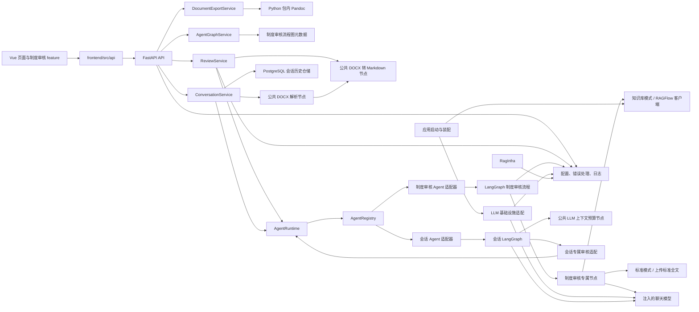

# 当前架构与架构约束

## 当前架构图

以下图示描述仓库当前代码中可见的主要调用关系，不表示尚未实现的规划模块。

图中 `Main` 创建模型，在 RAGFlow 配置完整时创建可选 RAG 客户端，并将其和制度审核并发配置交给 Agent 构建上下文。聊天模型配置就绪即可初始化运行时。知识库模式调用注入的 `app.infrastructure.ragflow.client.RagFlowClient`；标准模式比较上传标准全文，不调用检索或 embedding。不要把图理解为已经存在通用的 RAG 节点或服务抽象。

制度审核图构建时创建共享异步并发额度，由同进程的制度审核请求共用。原始 `clauses` 和执行 `chunks` 分开保存；仅标准模式将超过 30 个块的相邻条款合并为 30 组。依据来源选择、分组、发现定位和并发规则属于制度审核 Agent，通用 `runtime/` 不承载这些业务规则。就绪接口主状态反映模型配置和运行时，两种模式的配置状态分开报告，不检查外部连通或额度。

父图直接将 `graph/chunk_review.py` 构建的编译子图注册为既有 `review_clauses` 节点。子图通过官方 `Send` 向知识库或标准模式专属 worker 分发每个 chunk，以私有 `chunk_results` reducer 累积，校验分组及原条款完整性后显式排序，只回写 `clause_reviews` 和 `references`。不保留节点内批量任务调度入口、兼容包装或旧路径回退；两个 worker 共用父图创建的 semaphore，术语、报告和建议不占用条款额度。`max_concurrency` 不替代同进程跨请求额度，静态流程页面不展开动态任务。

按当前父图边关系和 LangGraph superstep 语义，拆分与术语检查先并行执行，该步全部完成后才启动条款子图；报告继续通过 AND 边等待子图整体及术语结果。原生图执行器负责本轮任务的异常和取消清理，失败不产出部分成功报告；未新增图层 RetryPolicy 或 checkpointer，重新提交会重做，不能跨进程或重启恢复。取消返回只保证本进程异步调用退出与额度释放，不保证供应商停止远端计算或计费。

显示标题规范化或截断时，另行保留原始文档标题供拆分定位使用，避免标题被当作正文。全文术语分支在调用模型前同样检查可审核内容；它与拆分并行运行，因此独立执行纯文本校验。报告仅携带问题相关依据，标准模式保留已验证摘录的完整内容，不沿用知识库报告片段截断。

只读流程结构接口 `GET /api/v1/agents/{agent_id}/graph` 由 API 路由委托给 `AgentGraphService`，再读取制度审核 Agent 中定义的静态图元数据。该响应描述节点和连线，不是 LangGraph 运行时状态或节点执行进度。

独立导出接口 `POST /api/v1/documents/export/docx` 委托 `DocumentExportService` 校验 Markdown、检查 AST 并设置 Word 样式，使用基础设施 `PandocRunner` 调用 pypandoc-binary 包内程序。服务在 lifespan 中独立于模型配置装配，持有同进程共享额度、取消及关闭逻辑。文件通过内存返回，未增加附件存储、MCP 或 Chat 工具，也不把转换放入制度审核图或 AgentRuntime。

导出复用锁定依赖中的 Pandoc 3.9 GFM reader 与 DOCX writer；GFM reader 将行内 ` ` 保留为 RawInline，因此服务在既有 AST 校验阶段仅将无属性 HTML 换行映射为官方 LineBreak 节点，不自行解析 Markdown 或全局替换原文。代码与转义文字保留，其他原始 HTML 和图片仍被拒绝；结构映射规则参考 [Pandoc 原生行内节点](https://pandoc.org/lua-filters.html#type-inline)，并以真实包内程序验证。

## 已有目录职责

会话永久删除属于 ConversationService 应用用例：复用同会话操作锁，拒绝上传、活动运行及仍在收尾的任务；PostgresConversationStore 在事务中按外键顺序删除关联记录，LocalFileStore 管理 `.deletions` 最小凭据和精确附件目录清理。数据库删除前落盘凭据，提交确认后才清理附件；启动只核对凭据所指会话，不扫描附件库。客户端断开不撤回已接纳删除，服务关闭等待删除收尾。该能力不进入 Agent 图或 runtime，不新增数据库结构或队列。

会话助手使用完整的 `agents/conversation_assistant/graph/` LangGraph，依次准备材料、构造上下文、识别意图和门控，再进入普通回复、澄清或审核子调用。参数合并、模式校验和目标白名单归 Agent；`ConversationService` 每轮只调用一次会话 Agent，负责后台任务、幂等、容量、超时、取消、上传用例和 HTTP 映射，不再解释意图或审核参数。

`infrastructure/conversation/postgres_store.py` 以 asyncpg 官方连接池和事务保存 agents 元数据、chat_sessions、messages、files 路径、runs、agent_calls 及版本化续接数据；初始化 SQL 独立放在 `backend/database/`，由部署者显式执行，应用启动不建表。事务内分配消息序号、约束幂等和每会话唯一活动运行，模型/解析调用不持有长事务。`active_runs.py` 只保存进程内活动事件、临时文本、互斥与额度，不维护第二份可修改持久历史。中立 DTO 位于 `schemas/conversation_session.py`，Agent 业务状态和本轮输入输出契约保持独立。未启用 checkpointer 或长期记忆 Store。

上传时调用 `nodes/document/parse.py` 完成格式及解压校验，并复用 `docx_to_markdown.py`，会话图使用解析结果，不重复解析。通用序列化预算及裁剪归 `nodes/llm/context.py`，会话材料选择归专属 `nodes/context_prepare.py`。模型输入预算为 24000 个序列化字符，历史子结果片段最多 4000 字符；这不是模型 token 上限。子调用按材料 ID 获取完整原文。

会话专属 `tools/institution_review.py` 只适配已接入审核能力；图通过构建上下文注入的调用函数，使用生产环境同一个 `AgentRuntime` 调用原有制度审核 Agent。注册期间不执行调用，全部注册成功后才发布运行时；制度审核图继续在启动时构建并共享额度，没有通用工具中心或自动多智能体执行循环。运行时结果契约不变，invoke 增加可选通用事件回调，通过 AgentContext 交给适配器，不引入 HTTP、存储或具体审核规则；注册表工厂允许注入注册表及调用函数以完成装配。

DOCX 上传可选，粘贴正文引用当前会话用户消息。消息、结果、待补齐审核参数与文件元数据保存在 PostgreSQL，不自动过期；服务关闭先回收后台任务，再关闭外部客户端。前端 `features/conversation-assistant/` 负责聊天交互，`AgentConversationView.vue` 负责页面组合。当前使用 SSE，普通回答流式，审核推送真实阶段和完整结果；不提供跨进程恢复或用户权限隔离。

会话适配器使用官方 LangGraph astream 单次驱动图，白名单输出 reply_chat 的文本，保留最终状态的校验和评估投影。应用服务接收文本/阶段事件，临时累计文本、变更通知与容量归活动运行状态，不放入 Agent 业务状态。SSE 订阅从同一运行读取 snapshot/delta/state/done，不重新调用模型，不建立事件日志或无界队列；终态回收临时文本占用。API 使用 FastAPI 官方 EventSourceResponse 与 ServerSentEvent；框架处理协议编码、心跳及响应头，应用服务只等待业务状态变化。依赖在开始流响应前校验运行，断开时通过标准库 aclosing 关闭订阅迭代器，不取消后台任务。

前端导航为宣传首页 → 智能体目录 → 独立智能体页面。App 使用 Vue KeepAlive 保留助手页面；会话 feature 在页面内存中持有已访问会话的消息、材料元数据、草稿、附件选择与失败重试快照，左栏展示会话记录。激活后读取会话并订阅活动任务，停用时中止客户端请求与 SSE，不取消后端任务；响应代次、会话/运行 ID 和订阅实例防止迟到事件串入新会话。原生 EventSource 限定错误重连，失败可进行一次状态读取并提示手动恢复，不回退周期轮询。现有 sessionStorage 仅保存当前会话、客户端消息 ID，以及 agent-platform-session-deletions 中待重试删除的 ID/phase 数组，不写入正文，不构成持久会话存储或新的全局状态管理层。

助手上传文件在输入框中预览，发送后随对应消息展示，不设右侧材料模块。独立审核仍走同步接口，停止等待仅使用 AbortSignal 中止客户端等待；报告以完整 Markdown 为真源，用 marked Renderer 生成章节定位，经 DOMPurify 清理后呈现，复制与 Word 导出使用原始完整内容。

### 数据库部署资产 `backend/database/`

该目录只放显式建库、建表 SQL，由部署者、数据库测试及 CI 调用，不属于 `backend/app/` 的 Python 运行时模块，也不打入应用 wheel 的包数据。数据库驱动适配与查询事务仍归 `app/infrastructure/conversation/`。表结构与初始化规则集中在 [数据库设计与初始化](../database.md)，涉及结构、仓储和数据库测试时先阅读；变更 SQL 时同步维护该文档、测试及 CI 的引用。

### 后端 `backend/app/`

| 目录 | 当前职责与约束 |
| --- | --- |
| `api/` | FastAPI 路由和 HTTP 输入输出。将业务协调委托给服务层。 |
| `core/` | 配置、统一错误和日志等应用级基础能力。 |
| `services/` | 应用用例协调，服务模块使用 `*_service.py`。会话只保留 `conversation_service.py`，不承载 Agent 编排或存储/解析/上下文辅助文件。原独立审核与导出服务仍承担各自用例。 |
| `runtime/` | 通用智能体调用上下文、注册表、分发和执行结果。 |
| `agents/` | 具体智能体及其构建入口。当前由 `agents` 包发现子包并调用 `register_agent`。 |
| `agents/institution_review/graph/` | 制度审核 LangGraph 状态、图和路由边。 |
| `agents/institution_review/nodes/` | 制度审核专属节点、提示调用和业务结构。 |
| `nodes/` | 公共处理能力，包括 DOCX 转换、解析校验和 LLM 输入预算。会话业务材料选择不进入通用 LLM 节点；公共节点也可独立于图调用。 |
| `infrastructure/` | 外部系统/SDK 适配及具体存储实现，包括聊天模型、RAGFlow、Pandoc 和会话 PostgreSQL 仓储及活动内存状态。存储实现不解释 Agent 业务或返回 HTTP View。 |
| `schemas/` | 应用级审核响应与引用等共享数据结构。Agent 私有结构保留在 Agent 包内。 |

### 前端 `frontend/src/`

| 目录/文件 | 当前职责与约束 |
| --- | --- |
| `api/` | API 基础客户端和审核 API 封装。 |
| `features/institution-review/` | 制度审核相关上传、报告和类型。新审核 UI 行为优先放在此 feature。 |
| `components/` | 多处实际共享的品牌入口与工作台执行状态组件。新建通用组件前确认存在多个真实使用点或明确共享契约。 |
| `features/conversation-assistant/` | 会话页面的请求生命周期、当前页面内历史快照、消息/输入/附件和会话记录展示；不承载后端 Agent 意图或业务路由。 |
| `views/` | 宣传首页、智能体目录与独立智能体路由页面的组合。 |
| `router/` | Vue Router 配置。 |
| `App.vue`、`main.ts`、`style.css` | 应用入口、外壳和全局样式。 |

## 依赖边界

- 后端 HTTP 路由依赖服务及应用级配置/错误设施；服务协调用例并调用运行时或明确可复用节点。
- `runtime/` 保持通用调用协议，不放入制度审核领域逻辑。
- Agent 的图、状态和私有节点属于相应 Agent 包；跨 Agent 复用的能力应先证明有真实复用需求，再评估放入 `nodes/` 或共享 schema。
- `infrastructure/` 处理外部系统/SDK 接入与具体存储实现。业务流程不应绕过已有服务/构建上下文任意新建外部客户端；Agent 不导入会话存储或反向依赖 services。
- 前端页面通过 `api/` 访问后端；业务 UI 细节归属 feature，`views/` 负责页面组合。
- 不因目录名称推导尚未存在的接口或职责。新增边界、跨层反向依赖或公共契约变化按治理流程请求确认。

### Langfuse 可观测性与 Prompt 边界

`core/observability.py` 定义中立观测接口和关联上下文，`infrastructure/langfuse/` 负责 SDK 客户端、回调、导出过滤和远端 Prompt 读取。`main.py` 装配并注入运行时、应用服务和 Agent 适配器；runtime 不导入供应商 SDK。异步会话 run 在后台入口建立独立追踪，以 request_id 关联提交请求，以 session_id 聚合会话，父子 Agent 及并发条款继承当前追踪。状态查询和 SSE 订阅不创建远端请求追踪。

公共 Prompt 契约和解析会话位于 `nodes/llm/prompts.py`，完整任务模板留在各 Agent 的 prompts.py。runtime 的可选异步执行作用域负责绑定解析器，独立节点调用默认使用本地模板。每轮同名 Prompt 固定首次选择的版本，远端日常故障可兜底；固定版本实验不兜底。模型输出 schema、材料角色和动作门控仍由 Agent 代码确定。

默认导出不保存输入输出、图状态或异常正文；显式启用正文采集后，Langfuse 的持久记录独立于会话内存 TTL，不用于恢复会话。Token 仅覆盖当前进程实际可见的模型调用，RAGFlow 内部计量仍由其自身提供。

`backend/scripts/` 提供显式 Prompt 同步与实验命令，发布及数据集写入需显式参数。实验复用现有 runtime/图，Agent 专属 evaluation.py 产生受控投影；不修改 HTTP 响应或会话存储，不自动采集真实文档作为数据集。评估器不进入通用 runtime。

## 复用、新模块与目录创建

1. 搜索相关符号、API、组件和调用方，再决定新增或复用。
2. 一个职责属于已有模块时优先扩展该模块。不要创建仅转发调用、包装一次或为未来复用而设的重复模块。
3. 新 Agent 应实现当前 `register_agent(registry, context)` 注册约定，并具有实际业务需求；新增通用运行时机制须单独说明必要性。
4. `backend/app/`、`frontend/src/` 下的新一级目录，以及新的仓库顶层目录，必须先说明现有目录为何不能承载职责并获得用户确认。
5. 新增文件放在已批准的职责目录内，并更新受影响的 README 或架构说明。

## 当前架构文档状态

`docs/superpowers/智能体平台项目架构图_v2.md` 是规划材料，其中的数据库、认证、stores、消息队列和其他模块不代表当前实现。评估变更时以代码和本文件的“当前架构图”为准；未来计划须明确标注为计划，并单独审批。

### 会话持久化运行边界

同一数据库由专用连接持固定 advisory lock，首版仅一个应用进程；第二实例拒绝启动。启动恢复遗留 queued/running 为中断失败，不调用模型。终态消息、完整结果、continuation 与运行状态原子提交后才发送 SSE done；终态提交失败或运行权丢失拒绝新写入，需要服务重启。客户端历史列表从后端按更新时间分页，消息按 sequence 前后分页；sessionStorage 不是历史真源。没有用户/租户隔离或历史自动清理。数据库、连接、池和取消故障采用官方 asyncpg API，不自建协议/心跳。

### 会话文件与智能体目录

`infrastructure/documents/local_file_store.py` 负责附件原件及已解析 Markdown 的本地暂存、目录发布、读取和精确清理；默认根为 backend/documents，DOCUMENTS_DIR 相对 backend 解析，路径按 agent_id/session_id/file_id 分级，数据库保存相对 POSIX 路径。ConversationService 协调解析、文件发布和元数据事务，取消等待不可中止的写线程；提交未确认时先查询 file_id，无法核实则保留文件，不盲删。文件与数据库不构成跨资源原子事务，崩溃可留下待核对孤立文件。Agent 只接收服务加载的 TurnDocument 正文，不导入文件或数据库存储。

AgentCatalogService 消费注入的 list_agents 查询，HTTP GET /api/v1/agents 和前端目录实际使用该元数据；运行执行仍由代码注册表控制。会话公共接口为 /api/v1/sessions，使用 session_id/message_id/run_id/file_id；文件返回元数据，不公开内部路径或静态目录。用户已批准丢弃旧表数据，本轮直接初始化 v2，不保留迁移或旧 HTTP 别名。

未来个人私有会话需要真实 users 与 chat_sessions.user_id，并在所有会话、运行、文件、SSE 和取消入口校验服务端身份。当前没有用户身份来源，不伪造用户、不接受客户端 user_id 授权、不以文件目录代替权限控制。
